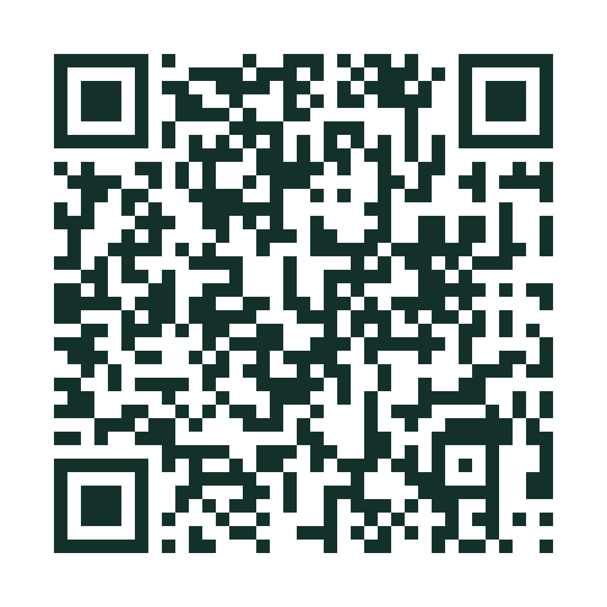

# Atendimento Psicológico Gratuito em Manaus

Página simples, feita para celular, que reúne os lugares de Manaus (AM) com **atendimento psicológico gratuito**: endereço com link para o mapa, telefone com botão de copiar e o que levar no dia.

**Acesse:** https://leonardojaquimenute.github.io/psicologia-gratuita-manaus/

## QR code

Aponte a câmera do celular para abrir a lista.

O cartaz pronto para imprimir está em [`cartaz-qrcode-psicologia-manaus-github.png`](cartaz-qrcode-psicologia-manaus-github.png).

## O que tem na página

| Seção | Conteúdo |
| --- | --- |
| Rede pública | Policlínica Gilberto Mestrinho, PAM Codajás, CAC – Cidade Nova e UBS Nilton Lins |
| Clínicas-escola | UNINORTE, ESBAM, FAMETRO, UFAM (CSPA), ULBRA (SPA), FMF (CAPSI) e Nilton Lins (SEPA) |
| Igrejas | Aparecida, São José Operário e Sagrada Família |
| Remédios | Como retirar medicação gratuita em UBS e Policlínicas |

> **Precisa conversar agora?** Ligue **188** (CVV). É gratuito e funciona 24 horas. Em emergência, ligue **192** (SAMU).

## Aviso

Dias, horários e telefones podem mudar. **Ligue antes de ir.** Se encontrar alguma informação errada ou desatualizada, [abra uma issue](https://github.com/LeonardoJaquimenute/psicologia-gratuita-manaus/issues) contando o que mudou.

## Como atualizar a lista

Todo o site está em um único arquivo, o `index.html`.

1. Abra o `index.html` aqui no GitHub e clique no ícone de lápis (Edit).
2. Altere o nome, endereço ou telefone do local.
3. Clique em **Commit changes**.

Em 1 ou 2 minutos o site é atualizado. O link e o QR code continuam os mesmos.

## Como foi feito

- HTML, CSS e JavaScript puros, sem frameworks nem build
- Layout pensado para celular, com tema claro e escuro automático
- Fontes [Bitter](https://fonts.google.com/specimen/Bitter) e [Atkinson Hyperlegible](https://fonts.google.com/specimen/Atkinson+Hyperlegible), esta última criada para facilitar a leitura
- Hospedagem gratuita no GitHub Pages

## Créditos

- Lista de locais divulgada pela **Casa do Psicólogo** · (92) 3233-5224
- Página feita por [Leonardo Jaquimenute](https://github.com/LeonardoJaquimenute)

A finalidade deste projeto é ajudar, com informação, quem precisa de atendimento psicológico gratuito em Manaus. Compartilhe.
